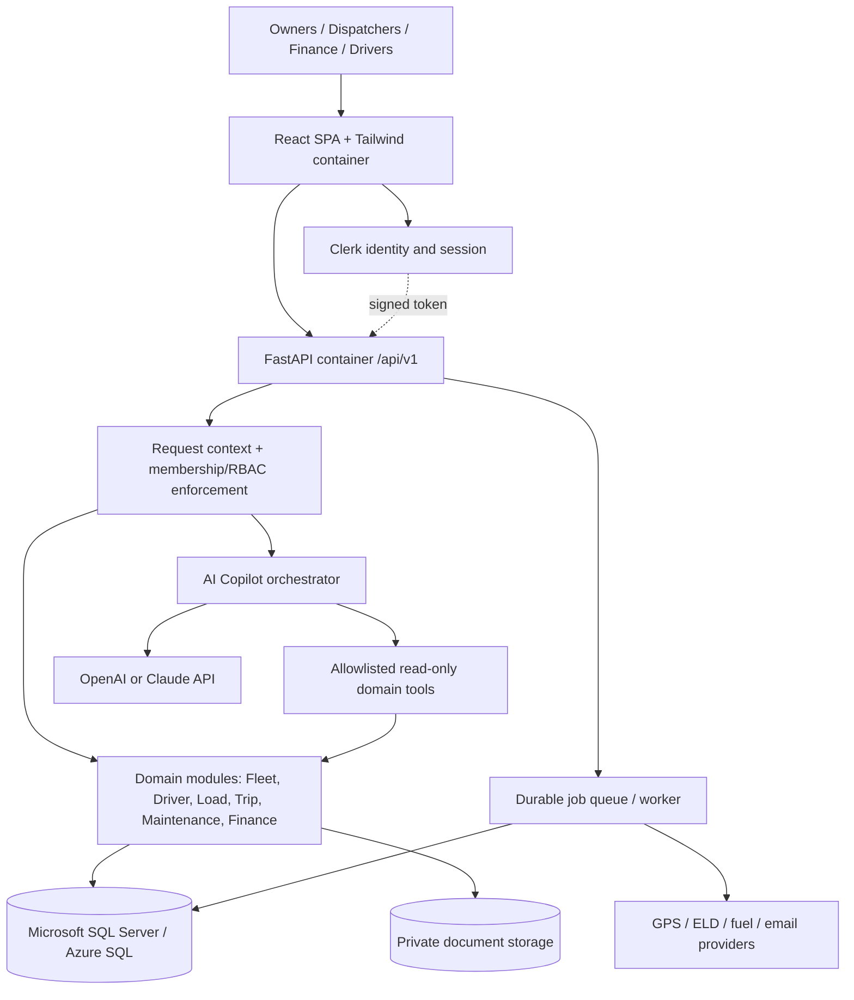

# FleetOps — Architecture Notes

**Document:** `docs/architecture-notes.md`  
**Version:** 1.5 | **Date:** 2026-11-22 | **Status:** Proposed target architecture; key deployment decisions subject to Gate 0 spike  
**Product authority:** [`../spec.md`](../spec.md) | **Agent rules:** [`../AGENTS.md`](../AGENTS.md)

## 1. Architecture principles

1. **Modular monolith first:** one Python FastAPI application with separated domains, public REST interface, and internal service boundaries; avoid premature microservices.
2. **SQL Server is source of truth:** events, caches, LLM responses, and dashboards must derive from authoritative records.
3. **Server-side tenant isolation:** the verified identity, membership, roles and tenant scope are checked on every protected route, service call and AI tool.
4. **Operational correctness before convenience:** truck out-of-service constraints, dispatch collisions, stale GPS, financial completeness and auditability are core invariants.
5. **External systems are unreliable:** ingest by replayable, idempotent background jobs; retain source provenance and last successful sync.
6. **AI is a read-only interface to permissions-aware domain queries:** never grant an LLM direct SQL access, unrestricted network access or business mutations.
7. **Portability where cheap:** use standards-based Python, SQL Server, OpenAPI, event schemas and object storage. Keep hosting-specific adapters at edges.
8. **Fail explicit:** distinguish unknown vs zero, stale vs live, estimated vs reconciled, authorized vs unauthorized.

## 2. Decision register

| ID | Decision | Status | Rationale / trigger to revisit |
| --- | --- | --- | --- |
| ADR-001 | React + TypeScript + Vite + Tailwind for SPA | Accepted for planning | Dense internal operational UI; no SSR requirement in P0 |
| ADR-002 | Python FastAPI modular monolith | Accepted for planning | Small team, cohesive business transactions, easy shared authorization |
| ADR-003 | Microsoft SQL Server database | Chosen by product | Azure SQL Database proposed for managed production |
| ADR-004 | Clerk React SDK + Python verification | Preferred, pending approval | Decouple identity from fleet membership/permissions; compare Supabase Auth |
| ADR-005 | Docker-first web/API/worker deployment; GitHub Actions + GHCR | Required; host approval pending | Azure Container Apps proposed; Vercel optional SPA hosting, not a container runtime |
| ADR-006 | AI SDK React with Python streaming backend | Conditional | Pin and test a compatible UI message protocol or text-stream transport |
| ADR-007 | A durable queue/worker for integrations | Required, provider TBD | Do not treat HTTP request tasks as durable queues |
| ADR-008 | Tenant-scoped shared database | Accepted for initial model | Supports single carrier and eventual SaaS; strict constraints, tests and RLS evaluation |
| ADR-009 | External ELD/telematics instead of building certified devices | Accepted | Regulatory and hardware risk reduction |
| ADR-010 | AI Copilot tools are read-only P0 | Accepted | No autonomous dispatch/finance/compliance changes |
| ADR-011 | VS Code + GitHub + Docker Compose for scaffolding and development | Required | Reproducible local and CI environments; optional Dev Containers |

Clerk-specific flows below describe the preferred spike configuration. Acceptance of an identity provider is recorded in ADR-004.

**2026-11-23 demo exception (ADR-004 unchanged):** The local-only `compose.demo.yaml` uses a signed, HTTP-only cookie and fictional SQL memberships so Feature 001 can be shown without a Clerk development instance. The account picker requires no password; anyone with access to the loopback demo can select a fictional persona. This is enabled only when `FLEETOPS_ENV=demo` and the database is `fleetops_demo_001`; web binds to loopback. It does not select or replace the production identity provider. The trusted Clerk flow and its revocation/outage proof remain open.

**2026-11-23 local operations demo extension:** Additive Alembic revision `0004_demo_operations` stores temporary equipment state, reservations, document bytes and costs in a `demo` schema with tenant row-level security. It is limited to the loopback demo and does not approve these tables as the production design. The production fleet, dispatch, GPS, maintenance, document and finance plans still require their target-model feature reviews and full acceptance gates.

**2026-11-23 local Copilot demo extension (ADR-006/010 unchanged):** Revision `0005_demo_ai_chat` adds member-scoped history and daily usage counts. The Python backend selects fixed, permission-checked SQL read functions and sends compact facts to a configured OpenAI Responses API model with provider storage disabled. It emits AI SDK v7 UI Message Stream framing with separate source metadata. If the provider is unconfigured, unavailable, or out of credit, a deterministic renderer uses those same authorized facts and labels its response as a database summary, never as model output. Exact unit numbers and trip references are resolved from bounded tenant-scoped asset and assignment reads before the fallback selects an answer; matching record citations are retained. Model calls are buffered before UI framing in this demo; the production AI streaming, provider choice, abuse evaluation, and consent/retention gate remain open. No model tool or text-to-SQL path exists.

**2026-11-24 deployment review (ADR-005 open):** Railway is the first application-host candidate for a live pilot following the user's hosting direction. This does not authorize exposing the loopback-only demo. Production identity, business routes, SQL Server migration/TLS, durable workers, private files, CI/GHCR promotion and staging smoke evidence are absent or incomplete. The host, Azure SQL connectivity design, region, cost and production release approval remain gated. See [Railway deployment readiness](railway-deployment-readiness.md) for observed blockers and the implementation sequence. Azure Container Apps remains an alternative if private database connectivity cannot be met on Railway.

**2026-11-24 staging slice update (ADR-005/006 still open):** A separate Caddy staging web image, production Alembic branch, read-only fleet-inventory AI route, SQL-backed chat history/usage cap, and controlled pilot-reader onboarding were implemented. At the time of this entry, the managed services and HTTPS checks had not yet been verified. The AI status does not claim seven-day retention because no purge worker exists. The pilot slice does not implement dispatch, GPS, maintenance, finance, or documents in the production data model. See [staging runbook](railway-staging-runbook.md) for the deployment sequence.

**2026-11-25 hosted workspace parity decision (ADR-004/005/010 unchanged):** Azure SQL and an Azure Container Apps API are connected to a Railway HTTPS web service. The user verified a Clerk session, an authorized carrier, two fictional tractors and an inventory-grounded AI response in staging. The local operations demo and hosted staging still have different authenticated application roots and database branches. The loopback demo uses the passwordless demo account picker, `demo` SQL schema and `/api/v1/demo/*` routes. Hosted staging uses Clerk, verified carrier memberships, the production SQL branch and read-only fleet-inventory/AI routes. The web workspace heading, carrier selector and section navigation may be shared across both roots. Matching the local *behavior* in hosted staging requires production-domain migrations and Clerk-authorized routes for dispatch, GPS, maintenance, documents, costs and reports, followed by the corresponding AI read tools and DEV-008 gates. The demo account picker, demo cookie and demo-only endpoints must not become public. A section that lacks production records must identify that limitation rather than fabricate a metric or imply a working action. Staging fictional records must remain explicitly labeled and tenant-scoped.

**2026-11-27 hosted operations release candidate:** The feature branch adds an additive `0006` staging operations migration, tenant-scoped Clerk-authorized routes for dispatch, last-known GPS, maintenance, documents, recorded costs and reports, read-only AI facts for those records, a shared workspace UI, and a guarded fictional seed. These are candidate code and tests, not evidence of live deployment. The local demo identity, cookie, and data remain confined to loopback. Release requires the controlled migration, Azure API and Railway web image promotion, one-shot seed, and signed-in live checks in [the staging operations runbook](staging-fictional-operations.md).

**Change control:** write a dated ADR entry or update this register when proof-of-concept evidence changes a decision. Do not replace SQL Server with PostgreSQL, Python with Node, or Clerk with Supabase without approval.

## 3. Logical system diagram



### Trust boundaries

- Browser is untrusted; its `tenant_id`, `driver_id`, role, visibility flags and generated queries are claims to validate, not authority.
- Clerk authenticates **who** the user is; FleetOps membership records determine **what** the user can access.
- AI model and external documents/notes are untrusted. The model may only invoke typed, approved tools; the backend still authorizes each call.
- Telemetry and webhooks are authenticated by provider-specific mechanisms, sanitized and durably deduplicated before updating operational records.
- Uploaded files are untrusted and never publicly readable by default.

## 4. Target repository structure

```text
fleetops/
├── spec.md
├── docs/
│   ├── architecture-notes.md
│   └── development-and-delivery.md
├── AGENTS.md
├── CLAUDE.md
├── .cursorrules
├── .cursor/rules/fleetops.mdc
├── apps/
│   ├── web/                       # Vite/React/TS/Tailwind
│   │   └── src/
│   │       ├── app/               # auth, layout, routing
│   │       ├── features/          # dashboard, dispatch, assets, ...
│   │       ├── components/ui/     # accessible design primitives
│   │       ├── lib/               # API/auth client
│   │       └── test/
│   └── api/
│       ├── app/
│       │   ├── main.py            # FastAPI entrypoint
│       │   ├── core/              # config, auth, DB, errors, observability
│       │   ├── modules/
│       │   │   ├── tenants/
│       │   │   ├── fleet/
│       │   │   ├── drivers/
│       │   │   ├── customers/
│       │   │   ├── loads/
│       │   │   ├── dispatch/
│       │   │   ├── trips/
│       │   │   ├── telematics/
│       │   │   ├── maintenance/
│       │   │   ├── documents/
│       │   │   ├── finance/
│       │   │   ├── reports/
│       │   │   └── ai/
│       │   └── integrations/      # external providers and queues
│       ├── alembic/
│       └── tests/
├── packages/
│   └── api-contracts/             # OpenAPI-generated types
├── compose.yaml                    # local services and network
├── .env.example                    # placeholders only
├── .vscode/                        # tasks, launch, extensions
├── .devcontainer/                  # optional reproducible tooling
├── infra/                          # Docker, IaC, operations
└── .github/workflows/             # checks, migration gate, deployment
```

**Dependencies:** `routes → application services → domain/repositories → persistence`. AI tools call application **query** services, never ORM session directly. Shared permission and audit libraries live in `core/`; avoid a monolithic `utils.py` domain dumping ground. Modules communicate through typed interfaces/events, not cross-module table writes.

## 5. Frontend design

- React/Vite SPA served from a production web container; TypeScript strict mode and Tailwind CSS. Choose accessible UI primitives (e.g., shadcn/ui) with component-level a11y checks.
- Feature folders own routes, view models, API hooks, forms, tests. Shared API client attaches a freshly acquired Clerk session token and correlation ID where needed.
- Router protects **user experience**, not data authorization; backend must re-check.
- Server query caching may use TanStack Query; cache keys must include effective company context and be purged on company switch/logout. Never persist sensitive finance/PII caches indefinitely.
- Operations screens favor desktop tables, keyboard-accessible dialogs and filters. Driver workflows are mobile-first and support queued offline events with visible sync state.
- Chat UI uses `@ai-sdk/react` with a deliberate transport choice. Version pinning, request shape, stream framing, auth headers, error handling and source metadata must be covered by integration tests.
- UI data labels: `available / in transit / maintenance / out of service`, GPS `fresh / stale / unavailable`, finance `estimated / incomplete / reconciled`.

## 6. Backend and cross-cutting request context

Every protected route uses a `RequestContext`:

```text
RequestContext {
  request_id: UUID
  identity_subject: Clerk subject
  user_id: internal UUID
  tenant_id: server-validated selected tenant UUID
  permissions: set of granted capability strings
  timezone: IANA name (for display/formatting only)
}
```

1. Verify Clerk signature and claims (issuer, audience/authorized party, expiration as appropriate); use supported SDK verification path, not hand-written trust of unsigned data.
2. Resolve internal user and active tenant membership from SQL Server. Reject disabled users/tenants/memberships.
3. Check capability and resource scope in endpoint **and service** layer. A membership selection from the browser is accepted only after verification.
4. Pass tenant-scoped repository access; log request ID, status, duration and non-sensitive resource identifiers.
5. External service/network calls use timeouts, bounded retries with jitter, and circuit breakers where appropriate; do not hold DB transactions open around LLM or network calls.

**Suggested capability names:** `fleet.read`, `fleet.write`, `dispatch.manage`, `trip.update_assigned`, `maintenance.manage`, `finance.read`, `finance.write`, `compliance.read`, `tenant.users.manage`, `ai.ask`. Centralize mapping to roles; do not encode authoritative permissions in client-managed metadata.

## 7. SQL Server model and invariants

**Types and conventions:** `UNIQUEIDENTIFIER` for IDs; `DATETIME2` UTC timestamps; `DECIMAL(19,4)` for USD amounts (with currency column where needed); `DECIMAL(18,3)` for miles/gallons/odometers where appropriate; `rowversion` or explicit integer version for optimistic concurrency; `NVARCHAR` for bounded text; documented `CHECK` constraints and filtered indexes. SQL Server does not have native PostgreSQL-style enums—use constrained codes/reference tables.

| Entity / tables (indicative) | Key fields and constraints |
| --- | --- |
| `tenants` | `id`, name, region, status, created_at |
| `users`, `memberships`, `roles` | user external subject unique; tenant/user membership unique; role/permission binding |
| `vehicles`, `trailers` | tenant_id, id, unit_no, vin, status, odometer; unique tenant/unit_no |
| `drivers` | tenant_id, id, user_id nullable, status, qualification expiries; sensitive field restrictions |
| `customers` | tenant_id, id, name, billing details, archive flag |
| `loads`, `load_stops`, `revenue_lines` | tenant_id + id; stop order unique per load; appointment zone, planned/actual times |
| `trips`, `trip_assignments`, `trip_events` | trip status and version; driver/truck/trailer IDs tenant-valid; immutable event IDs |
| `trip_exceptions` | type/severity, owner, state, opened/resolved times |
| `positions`, `vehicle_latest_positions` | provider record ID/source timestamps; unique provider event; latest only if newer |
| `maintenance_schedules`, `maintenance_records` | service interval, due date/odometer, vehicle status interactions |
| `fuel_transactions`, `expenses` | amount DECIMAL, category, source external ID, trip/vehicle allocation, reconciliation |
| `documents` | tenant_id, storage key, linked resource, media type, scan state, retention |
| `alerts`, `notification_outbox` | tenant, priority, subject, acknowledgment/delivery |
| `integration_connections`, `inbox_events` | provider, encrypted credential reference, source event ID, sync status |
| `audit_events` | tenant, actor, action, entity, before/after summaries w/o secrets, timestamp |
| `ai_conversations`, `ai_messages`, `ai_tool_calls`, `ai_feedback` | tenant/user ownership, response provenance, retention/status |
| `idempotency_keys`, `outbox_events` | tenant + operation + key, durable state/replay support |

The names above describe logical entities. For migration and query design, use the [schema-qualified physical dictionary](database/data-dictionary.md). For example, the vehicle domain uses `fleet.assets` and the latest-location projection uses `gps.latest_vehicle_positions`. The [planned report contracts](database/reporting-contracts.md) define the grain of derived reads.

**Tenant guards:** all tenant-owned tables include `tenant_id`; dependent relationships use tenant-scoped composite foreign keys (e.g., `(tenant_id, vehicle_id)` references `(tenant_id, id)`) or rigorously equivalent constraints. Use a tenant-bound repository contract, explicit query filters and authorization tests. Consider SQL Server Row-Level Security for defense in depth, but never rely on RLS alone, especially when pooling connections/session context.

### 7.1 Dispatch concurrency

- Preserve business invariants **inside a database transaction**. Check vehicle/driver availability and overlapping active trips under appropriate SQL Server locking or serializable transaction design; an application-only preflight check is racy.
- Use unique idempotency key on assignment endpoint; if two requests race, one succeeds and other receives `409 CONFLICT` (or replay of same successful idempotent result).
- Adjust for drop/reassign; document permitted overlap (e.g. a driver may have sequential trips if schedule windows don't overlap); route-specific optimization comes later.
- Out-of-service is a hard block when vehicle has an unresolved dispatch-prohibiting condition.

### 7.2 Trip lifecycle

`DRAFT → PLANNED → ASSIGNED → EN_ROUTE_TO_PICKUP → AT_PICKUP → IN_TRANSIT → DELIVERED → CLOSED` with controlled cancellation, correction and exception paths. Define a transition matrix in code, forbid arbitrarily setting state by generic PATCH, and audit actor+source+old/new state. Keep client occurrence and server receipt timestamps for the timeline. Under the trip transaction, validate progression against the current committed state and version. Concurrent submissions can share a timestamp. Differentiate **trip status** from **exception state**, **POD completeness**, **cost reconciliation** and **invoice readiness**.

The trip service owns the transition and its event as one commit. Organize commands by the resulting operational fact:

| Command | Preconditions and durable result |
| --- | --- |
| Plan trip | Verify dispatch permission and load ownership. For P0, link one commercial load through `ops.trip_loads` and map each execution stop to a stop on that load. Hold the trip row lock across the cardinality check and insert. Multi-load dispatch needs a later feature decision. Reject a stop from an unrelated load. Return the planned trip ID and version. |
| Assign or reassign | Lock old and requested resources in deterministic order. Check availability over the half-open interval from start inclusive to end exclusive. Commit the reservation changes, assignment history, trip version, audit and required outbox row together. A failed replacement preserves the original assignment. |
| Record stop event | Resolve the current driver assignment or dispatch capability at submission. Deduplicate the event and validate the expected trip/stop state. Record both occurrence and receipt time. A duplicate cannot advance a second stop. A delayed event incompatible with current state returns a conflict for review. |
| Confirm delivery | Link each confirmation to its delivery stop. Transition the trip to delivered once its required deliveries are confirmed. The delivery link and verification decision each identify the exact (tenant, document, version) in private storage. Eligibility requires a passing scan and the approved verification outcome for the same submitted version. Uploading another version requires its own checks. |
| Close or cancel | Apply approved transition rules, record actor and reason, and release applicable remaining reservations under the dispatch locks. Maintain distinct operational and financial records. Agree permissible cancellation and closure preconditions with the pilot operator before enabling either command. |

### 7.3 Financial rules

- `direct_contribution = recognized_load_revenue - attributable_direct_trip_costs`.
- Shared overhead and per-vehicle fixed costs must be allocated explicitly to claim operating or net profit.
- `CPM = included_operating_costs / selected_distance_miles`, `RPM = applicable_revenue / selected_distance_miles`; guard zero/unknown denominators. Specify loaded vs total miles per report.
- Do not equate “missing expense” with `0`; report cost coverage and `estimated/incomplete/reconciled` status.
- Keep original source transaction, adjustments and reconciliation history, never mutate historical financial figures without an audit trail.

Use allocated revenue and expense amounts at tenant, trip and currency grain. Aggregate each side independently before joining mileage or document data. A detail query, CSV export and permitted AI tool reading the same revision use the same calculation service and coverage policy. An incomplete calculation returns the known subtotal, missing inputs and the applicable distance basis. A finalized result references its closure revision. Preserve that revision and create an audited adjustment when authorized.

## 8. API conventions and example contracts

- Prefix `/api/v1`; OpenAPI maintained with implementation and generated TS types; canonical resource IDs UUID, stable external business numbers separate.
- Standard error envelope: `{"error":{"code":"DISPATCH_CONFLICT","message":"Truck is already assigned","details":{}},"request_id":"..."}`; safe messages only. Standard success: typed JSON; cursor pagination for lists.
- `401` no valid identity; `403` known forbidden capability; `404` unknown or resource not disclosable; `409` state/idempotency concurrency conflict; `422` validation; `429` rate limit.
- Use `Idempotency-Key` for event submissions/assignments/import triggers; version checks (`If-Match` or resource_version) for mutable records.
- Never accept `tenant_id` as unverified query authorization; select tenant in verified context and validate returned resource ownership.

| Endpoint | Auth | Notes |
| --- | --- | --- |
| `GET /api/v1/me` | signed in | memberships/permissions for UX |
| `GET/POST /api/v1/vehicles` | fleet.read/write | tenant-scoped, paginated |
| `GET/POST /api/v1/loads` | dispatch / manager | revenue fields permission-filtered |
| `POST /api/v1/trips` | dispatch.manage | plan a trip and its ordered stops in one idempotent transaction |
| `POST /api/v1/trips/{id}/assignments` | dispatch.manage | transactional conflict checks |
| `POST /api/v1/trips/{id}/events` | dispatch or assigned driver | transition machine + idempotency |
| `GET /api/v1/vehicles/{id}/positions` | fleet.read | retention/sensitivity bounds |
| `POST /api/v1/trips/{id}/documents` | assigned driver or dispatcher | private signed upload workflow |
| `GET /api/v1/reports/trip-contribution` | finance.read | denominators and completeness |
| `POST /api/v1/ai/chat` | ai.ask + tool permissions | rate limits, audited read-only tools |

## 9. AI Copilot design

### 9.1 Tool route

```text
React Copilot panel (@ai-sdk/react)
   -> authenticated POST /api/v1/ai/chat
   -> FastAPI chat orchestrator
      -> verify tenant, permission, budget, request limits
      -> choose allowlisted read-only tool(s)
      -> call typed FleetOps query services with RequestContext
      -> return compact, source-linked data to selected model
      -> stream guarded answer + metadata back to UI
```

**No text-to-SQL. No arbitrary Python execution. No LLM-triggered writes.** Provider keys are server-side only. Inputs from documents/driver notes are data, never instruction authority. All per-tool query limits are bounded.

### 9.2 Approved P0 tools

| Tool | Input | Output (all tenant/permission scoped) |
| --- | --- | --- |
| `getFleetSummary` | date range | truck counts, active trips, latest update timestamps |
| `getAvailableVehicles` | requested interval, equipment filters, limit | eligible candidate IDs and availability as of the query time. Assignment rechecks restrictions and reservations. |
| `getDelayedTrips` | period, limit | trip IDs, reason/status, ETA source |
| `getTripStatus` | trip ID | authorized stop/assignment/status timeline |
| `getVehicleLocation` | vehicle ID | last known coordinates/place, observed/received timestamps, freshness |
| `getMaintenanceDue` | date/window | vehicles, service type, due basis |
| `getDriverAssignments` | time window | allowed driver/assignment summary, no unnecessary PII |
| `getTripFinancialSummary` | trip ID or bounded period | revenue/cost/contribution, completeness, underlying record references |

### 9.3 Streaming compatibility spike

Use `@ai-sdk/react` with a selected and **version-pinned** protocol. The AI SDK supports text-stream transport and a structured **UI Message Stream Protocol** for mixed text/data/tool/source parts, including non-JavaScript backends. Implement matching FastAPI `StreamingResponse` framing, headers, auth and disconnect behavior. For the first spike, plain text-stream may establish connectivity; for P0 beta, source-linked records must be delivered in an explicit, tested structured response/channel (UI Message Stream or a separate authenticated references endpoint), not only model-generated citations. Keep an automated browser↔FastAPI streaming contract test. Confirm the chosen AI SDK major version and current protocol before coding.

### 9.4 Grounding, security and evaluation

- Authorized tool result is sole source for fleet facts; model may summarize but not invent records, legal determinations, amounts or current locations.
- Include source record IDs, `observed_at`, cost coverage, query time, and relevant filters in response metadata. Source links recheck access.
- Model-side context can specify a current vehicle/trip only if the server validates its tenant association and user capability.
- No HOS “compliant” claim without approved rule source and accurate provider data; missing/outdated feed is “not verified.”
- Save conversation data per tenant/user with consent/retention policy. Avoid storing secrets and unnecessary driver PII in prompts/logs.
- Rate limit by tenant/user; set max tools/response tokens/timeouts/cost budgets. Emit aggregated latency, usage, provider errors, and feedback.
- Golden-set tests must include normal, empty, stale, contradictory, cross-tenant, financial-permission, prompt-injection and tool-error cases. **Zero unauthorized disclosures** is a hard release gate.

## 10. Integrations, jobs and delivery of events

1. Provider API/webhook intake validates signatures, timestamp and replay rules; durable event recorded with provider key.
2. Worker processes event using retries with bounded backoff; record failures in dead-letter/retry view.
3. Normalize vehicle identity/time units and preserve raw provider reference; deduplicate.
4. Upsert state transactionally; publish a trusted internal event via transactional outbox where a cross-process follow-up is needed.
5. Alert/dashboards refresh through polling or appropriately managed push; correctness never depends on browser state.

**Retry and recovery contract.** Authenticate the caller and check current permission on the resource before returning any cached mutation result. Scope a key to tenant, operation and submitting membership or integration connection. In the proposed schema, the service encodes the operation and immutable actor/source identifier into a bounded, unambiguous `operation_scope`; enforce the unique `(tenant_id, operation_scope, request_key)` key. Check replay before the stale-version guard so a successful retry can return its original result. Bind it to a canonical payload fingerprint. Identical completed requests replay their authorized result. Changed payloads return a conflict. The transaction that commits the business effect also commits its deduplication record and any required outbox entry. A timeout before the caller sees the response is recoverable with the original key.

A relay may publish an outbox event twice if acknowledgement is lost. The consumer records the stable event ID with its local effect in one transaction and acknowledges after commit. For an external effect, use the destination’s idempotency support or reconcile an ambiguous outcome before resending. Verify the commit-before-response and publish-before-acknowledgement cases with synthetic records at the relevant feature gate.

**Worker boundary:** run a dedicated worker container from the API image with its own entrypoint and scaling policy; use a durable queue and SQL-backed idempotency/outbox. Scheduled reconciliation uses authenticated jobs. Vercel, if used for the SPA, is not the worker runtime. See `development-and-delivery.md`.

## 11. Production topology and environments

```text
Development: VS Code + Docker Compose (web/API/worker/queue/SQL Server)
CI: GitHub Actions + isolated SQL Server container + mock identity/providers
Staging: GHCR image digests on approved container host + dedicated staging database
Production: same approved image digests + managed SQL Server-compatible database + private storage + durable queue
```

**Do not share production database, Clerk keys, private files, or AI provider secrets with preview environments.** Use least-privilege DB principals, encrypted TLS connections and a secure network strategy for database connectivity. Confirm container host private network/egress needs and Azure SQL firewall posture; never open SQL Server broadly to the internet for convenience.

### 11.1 SQL Server driver spike (mandatory)

Microsoft offers both `pyodbc` and the `mssql-python` driver, with SQLAlchemy integration in current versions. Choose one **only after testing** in the selected Linux Python container image. Verify SQLAlchemy/Alembic compatibility, native dependency packaging, TLS settings, Azure SQL authentication, pool reuse/exhaustion, Unicode and DECIMAL round-trip, query latency, and migration permissions. If packaging or networking fails, resolve the driver/base image or private routing and record an ADR before changing the hosting model; do not weaken TLS.

### 11.2 Secrets / configuration

Expected categories (names to finalize): `CLERK_*`, `DATABASE_URL` or structured SQL host settings, `OPENAI_API_KEY` or `ANTHROPIC_API_KEY`, object storage credentials, queue credentials, provider webhook signing keys, telemetry/monitoring config. Maintain `.env.example` with placeholders only when scaffolding. Never commit real `.env`, connection strings with passwords, certificates, JWTs, or telemetry credentials.

## 12. CI/CD, migrations and operations

**GitHub Actions required jobs:** TypeScript typecheck/lint/unit; Python Ruff/type checking/pytest; OpenAPI contract drift; SQL Server migration and FastAPI integration tests; Selenium WebDriver browser journeys through the built SPA, API and SQL Server; security/secret scanning; build and artifact checks. For releases, CI checks gate deploy. Use GitHub Actions as the only deployment authority; disable competing automatic deployment triggers. Publish to GHCR and promote digests through approved environments. Protect main branch and require review. See `development-and-delivery.md`.

**Migrations:** Alembic versioned scripts targeting SQL Server; deploy backward-compatible schema additions before code requiring them; use expansion/transition/contraction for destructive changes; back up and rehearse recovery; separate migration principal from runtime DB role; never migrate production schema ad hoc during a request.

**Observability:** trace ID per request/job and source event; monitor p95 reads, endpoint error rates, blocked dispatch conflicts, queue age/DLQ, GPS data freshness, AI latency and spend, SQL pool saturation, tenant-scoping failures, and restoration outcomes. Logs redact tokens, PII, raw location unless operationally necessary, financial details and model-sensitive content.

**Backups:** define RPO/RTO with stakeholders; enable managed SQL backup/PITR and object-storage versioning; conduct a recovery drill before controlled pilot. Incident runbooks cover provider outage, database exhaustion, data leak, driver sync failure and AI provider unavailability.

## 13. Security and compliance guardrails

- Apply OWASP ASVS-style controls appropriate for a B2B app: auth/session validation, CSRF mitigation where cookies used, secure CORS, input validation, server authorization, secret rotation, rate limiting.
- Require verified signatures and replay defense for Clerk/provider webhooks. Do not trust an asserted organization ID without a local membership lookup.
- Audit changes to rates, vehicle out-of-service states, dispatch assignments, financial finalization, permissions and sensitive exports.
- Restrict driver location and qualification information by role and purpose. Define retention, access notices, delete/export process and incident response before production.
- The product does **not** self-certify ELD devices or legal compliance; recordkeeping/integration workflows require subject-matter and legal review before marketing claims.

## 14. Architecture spike / proof-of-concept checklist

The following must run in an actual deployable environment before declaring the stack ready:

- [ ] Vite/React build in a production container with environment-specific API base path.
- [ ] Clerk React login and valid signed token verified in FastAPI; invalid/revoked token denied.
- [ ] SQL Server CRUD (one `tenant`, one `vehicle`) from the deployed FastAPI container; secure TLS, driver import, connection timeout, DECIMAL, UTC dates and Alembic migration validated.
- [ ] Tenant A cannot access tenant B vehicle via ID, list, export, or Copilot tool.
- [ ] Concurrent assignment test yields one success and one conflict.
- [ ] Stream a text response from FastAPI to `@ai-sdk/react` through the production container ingress; test disconnect/retry.
- [ ] Stream or separately deliver authenticated source references; tested with the pinned SDK protocol.
- [ ] Asynchronous provider event accepted, durably queued, retried/deduplicated and inspected on failure.
- [ ] Observe database connection counts, container resource and ingress limits, telemetry frequency, logging costs and AI provider consumption.
- [ ] Document decisions and any hosting/driver deviations in ADR register.

## 15. Known risks, not yet resolved

| Risk | Gate/mitigation |
| --- | --- |
| SQL Server native driver in Linux image | Gate 0 deployment spike; pin tested base image and driver |
| Secure container host → Azure SQL network route and connections | Verify egress, firewall/TLS, pool and load testing |
| AI SDK React ↔ Python stream drift | Pin versions; contract test framing and metadata |
| High-volume telemetry / long-running jobs | Durable queue, dedicated worker, benchmark provider rate |
| Complex dispatch rules / driver HOS | Separate availability from legal eligibility; expert review |
| Accounting accuracy with partial data | Provenance, reconciliation labels, Decimal and adjustment audit |
| Tenant/PII disclosure through AI | Tool allowlist, server RBAC, redaction, injection tests |
| Vendor cost and outages | Adapter interfaces, budgets, retries, fallback UX |

## 16. Authoritative external documentation (recheck at implementation time)

- Docker Compose: https://docs.docker.com/compose/
- GitHub Actions: https://docs.github.com/en/actions
- Azure Container Apps: https://learn.microsoft.com/en-us/azure/container-apps/overview
- Vercel AI SDK UI stream protocols: https://ai-sdk.dev/docs/ai-sdk-ui/stream-protocol
- `useChat`: https://ai-sdk.dev/docs/reference/ai-sdk-ui/use-chat
- Clerk Python backend: https://clerk.com/articles/how-to-add-authentication-to-a-python-backend
- Microsoft `mssql-python`/SQLAlchemy: https://learn.microsoft.com/en-us/sql/connect/python/mssql-python/sqlalchemy-integration
- Cursor project rules: https://docs.cursor.com/context/rules-for-ai

**End — architecture notes v1.5**

## Database design companion v1.1
See [database architecture](database/database-architecture.md), [dictionary](database/data-dictionary.md), [ERD](database/entity-relationship.md), and [migration roadmap](database/migration-roadmap.md). These refine the proposed physical model; runtime DDL, RLS, grants and integration choices require Gate 0 validation.
